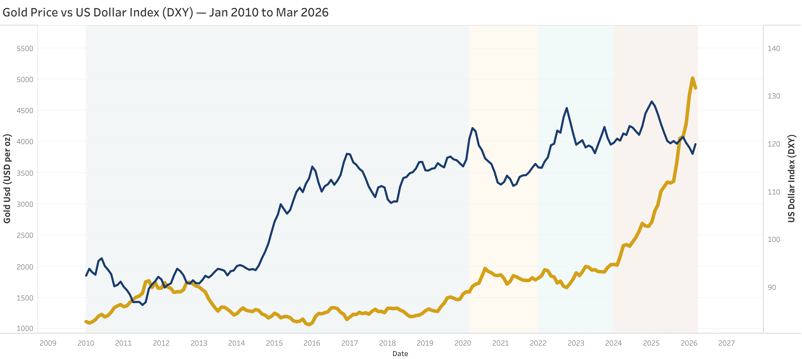
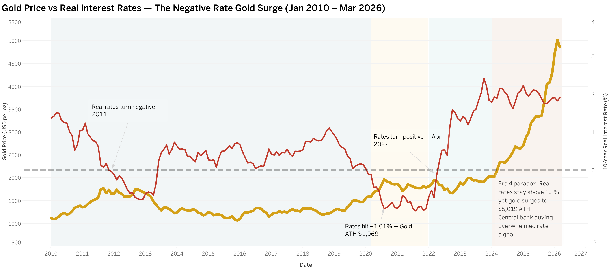
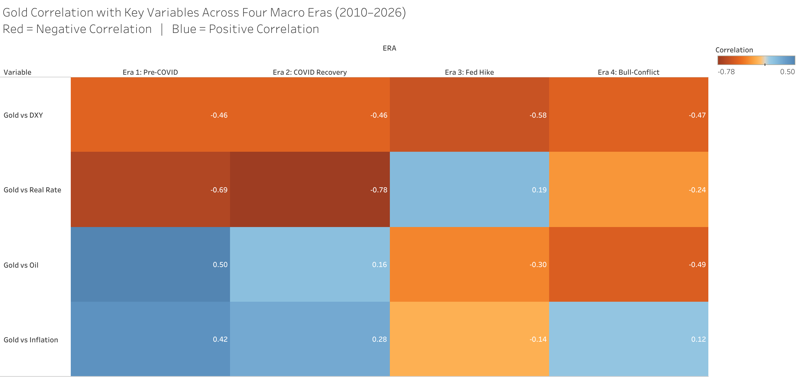
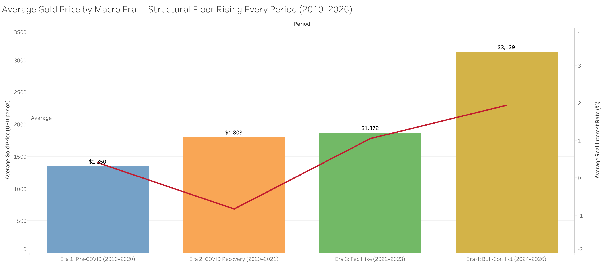
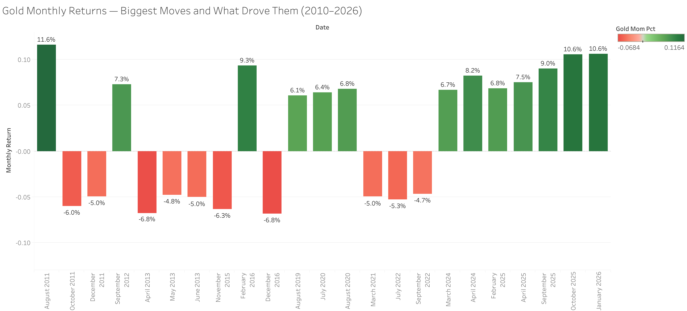

# Why Does Gold Fall During War? A Statistical Study of Gold, 2010–2026

> **Research question:** Why did gold drop ~22% (from an all-time high of $5,019 in Feb 2026 to ~$3,900) during the Iran–Israel–USA conflict, when every conventional framework predicts the opposite?

An independent analysis of **195 monthly observations (Jan 2010 – Mar 2026)** across six variables, using five statistical tests and a four-era macro framework.

**Read the report:** [`Gold_Analysis.pdf`](Gold_Analysis.pdf) · [`Gold_Analysis.pptx`](Gold_Analysis.pptx)

## Headline findings

1. **Gold and the dollar broke their historic relationship.** Full-period correlation is +0.43, not negative as theory predicts. Averaging four different regimes into one number hides this.
2. **Relationships are regime-dependent.** Gold vs real rates was -0.69 pre-COVID and -0.78 in 2020-21, flipped to +0.19 during the 2022-23 Fed hiking cycle, then only partly recovered (-0.24).
3. **Real rates were gold's master, until 2022.** Real rates hit +1.94% yet gold still surged to $5,019, pointing to structural central-bank buying (de-dollarisation).
4. **Regression:** R² = 0.40. Inflation expectations are the dominant predictor; oil is not significant on its own (p = 0.07) and acts only through the inflation channel.
5. **The price floor rose every era:** $1,068 → $1,592 → $1,664 → $2,023.
6. **Fiscal credibility beats war.** The largest monthly move (+11.6%, Aug 2011) came from the US debt-ceiling crisis, not a conflict.

**Conclusion:** the 2026 conflict was both gold's biggest supporter (+10.6% in Jan 2026) and its biggest headwind. The oil shock kept the Fed hawkish and the dollar strong, which overwhelmed the safe-haven bid.

## Interactive dashboards (Tableau Public)

All visuals were built in Tableau. Full portfolio: [Satya Narayan Sahoo on Tableau Public](https://public.tableau.com/app/profile/satya.narayan.sahoo/vizzes)

| Dashboard | Preview | Link |
|---|---|---|
| Gold vs US Dollar Index (DXY) |  | [Open](https://public.tableau.com/app/profile/satya.narayan.sahoo/viz/GoldAnalysis_17825425352930/GoldvsDXY) |
| Gold vs 10-Year Real Interest Rate |  | [Open](https://public.tableau.com/app/profile/satya.narayan.sahoo/viz/GoldPricevsRealInterestRates/GoldvsRates) |
| Gold correlation across four macro eras |  | [Open](https://public.tableau.com/app/profile/satya.narayan.sahoo/viz/GoldCorrelationwithKeyVariablesAcrossFourMacroEras2010-2026/CorrelationHeatmap) |
| Average gold price by macro era |  | [Open](https://public.tableau.com/app/profile/satya.narayan.sahoo/viz/AvgGoldPricebyMacroEra/GoldbyEra) |
| Gold monthly returns: major volatility |  | [Open](https://public.tableau.com/app/profile/satya.narayan.sahoo/viz/GoldMonthlyReturns-MajorVolatility/GoldMonthlyReturns) |

## Data

| Variable | Source |
|---|---|
| Gold spot price (USD/oz, LBMA PM) | World Gold Council |
| US Dollar Index (broad) | FRED `DTWEXBGS` |
| 10-yr real interest rate | FRED `DFII10` |
| WTI crude oil | US EIA |
| 10-yr breakeven inflation | FRED `T10YIE` |
| Central bank gold demand (tonnes) | World Gold Council Goldhub |

Daily series were converted to monthly averages; quarterly central bank demand was forward-filled across months.

## Method

- **Tests:** Pearson correlation matrix, era-by-era correlations, multiple linear regression, 12-month rolling volatility, descriptive statistics by era.
- **Eras:** Pre-COVID (2010–Feb 2020) · COVID recovery (Mar 2020–2021) · Fed hike cycle (2022–2023) · Bull & conflict (2024–Mar 2026).
- **Tools:** Microsoft Excel (Data Analysis ToolPak), Tableau Public for visuals.

## Repository

```
README.md                     This write-up
Gold_Analysis.pptx / .pdf     Full report
gold_*.png, correlation_*.png Tableau visualisation previews
Master_Sheet.xlsx             Consolidated monthly dataset and analysis
```

## Limitations

Monthly averages smooth intra-month volatility; Pearson correlations capture only linear relationships; R² of 0.40 leaves 60% of variance to factors outside the model (central bank buying, ETF flows, sentiment).

## Author

**Satya Narayan Sahoo** · MBA (Finance & Business Analytics), Birla Global University

*This is an independent academic analysis and does not constitute investment advice.*
